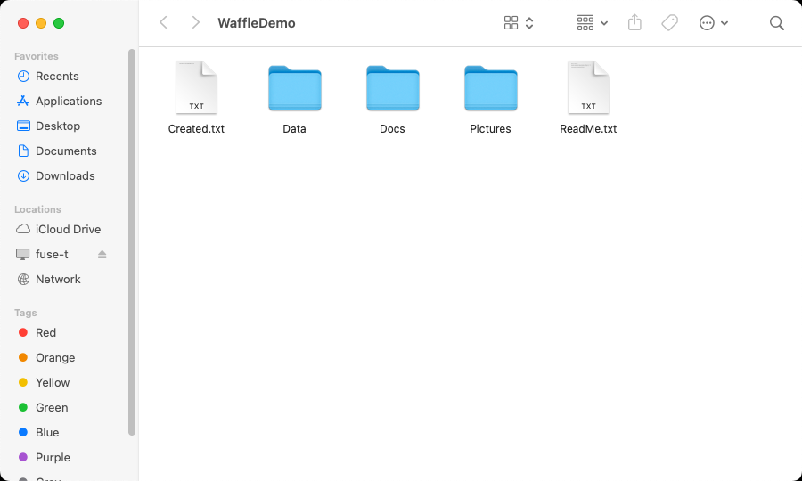
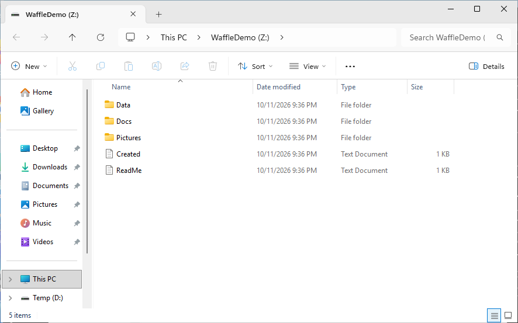
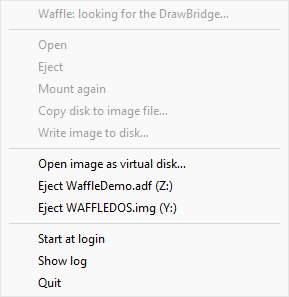
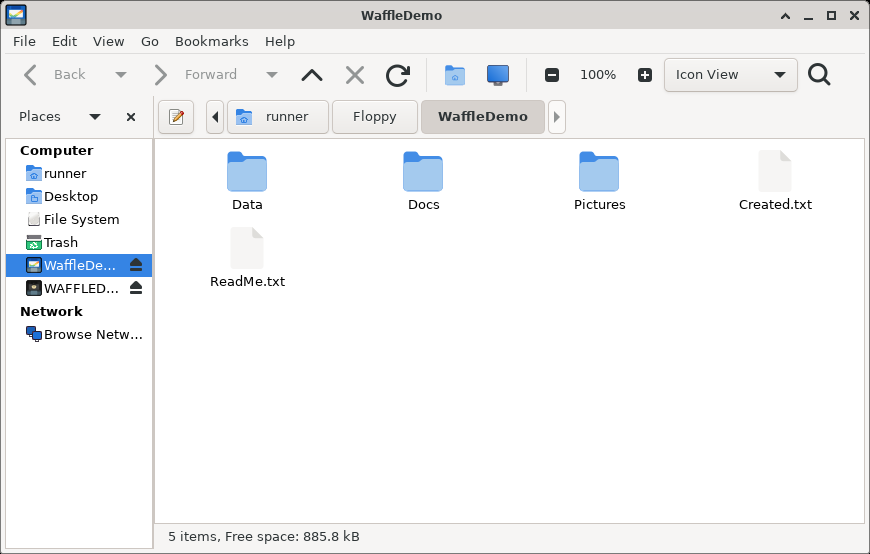

# Installation Guide - waffle-fuse with Bundled FUSE Dependencies

> **v1.2.6-beta and later**: Now includes pre-bundled FUSE dependencies on all platforms!

## Quick Start

### macOS
1. Download **Waffle-DiskFlashback-0.0.0.dev62.dmg**
2. Double-click to mount, drag **Waffle DiskFlashback** to Applications
3. Run from Applications - FUSE-T is already included! 🎉

### Windows
1. Download **waffle-fuse-setup-0.0.0.dev62.exe**
2. Run the installer - WinFsp is automatically included! 🎉
3. Applications appear in Start menu

### Linux
```bash
# Debian/Ubuntu
sudo apt install ./waffle-fuse_0.0.0.dev62-1_amd64.deb

# Fedora
sudo dnf install ./waffle-fuse-0.0.0.dev62-1.x86_64.rpm

# Arch/Manjaro
sudo pacman -U ./waffle-fuse-0.0.0.dev62-1-x86_64.pkg.tar.zst

# Any distribution
tar xzf waffle-fuse-0.0.0.dev62-linux-x86_64.tar.gz
cd waffle-fuse-*
./install.sh
```

---

## Platform-Specific Installation

### 🍎 macOS (macOS 12+, Apple Silicon & Intel)

**What's included:**
- ✅ **FUSE-T** (libfuse3.4.dylib) bundled in DMG and tarball
- ✅ **Waffle DiskFlashback** menu bar application
- ✅ **waffle-fuse** command-line driver
- ✅ All licenses included

#### Option 1: DMG (Recommended for GUI)

```bash
# 1. Download Waffle-DiskFlashback-0.0.0.dev62.dmg
# 2. Double-click to mount
# 3. Drag "Waffle DiskFlashback" to Applications folder
```

**First time setup:**
- macOS will refuse to open it (security check)
- Go to: **System Settings → Privacy & Security → General**
- Click **Open Anyway** next to the app
- Or run: `xattr -dr com.apple.quarantine "/Applications/Waffle DiskFlashback.app"`

**Allow permissions:**
- First disk insert will ask for permissions
- Grant access to: disk management, notifications, accessibility

**Features:**
- Menu bar floppy icon (grey/orange/blue status)
- Automatic mounting at `~/Floppy/<volume name>`
- Right-click menu: Open, Eject, Mount, Copy to image, Write image
- Double-click `.adf`/`.img` files to open as virtual disks

#### Option 2: Tarball (Command Line)

```bash
# Download waffle-fuse-0.0.0.dev62-macos-universal.tar.gz
tar xzf waffle-fuse-*.tar.gz
cd waffle-fuse-*
xattr -dr com.apple.quarantine .

# Use Waffle Floppy.command launcher
open "Waffle Floppy.command"

# Or command line
./waffle-fuse --help
./scripts/waffle-mount.sh   # one-click mount/eject
```

**Contents:**
```
waffle-fuse/
├── waffle-fuse              # Command line driver
├── waffle-mount.sh          # Mount/eject launcher
├── Waffle Floppy.command    # Finder launcher
├── LICENSE                  # Project license
├── README.txt               # User guide
└── fuse-t-lib/
    ├── libfuse3.4.dylib     # FUSE-T library (universal binary)
    └── LICENSE-FUSE-T       # FUSE-T license (MIT/BSD)
```

**Environment variables:**
```bash
WAFFLE_DEBUG=1 ./waffle-fuse --image disk.adf mnt/    # Verbose
export WAFFLE_MOUNT_DIR=~/DisksAndImages              # Change mount location
```

---

### 🪟 Windows (Windows 10 1903+)

**What's included:**
- ✅ **WinFsp** (winfsp-x64.dll, winfsp-x86.dll) bundled
- ✅ **Waffle DiskFlashback** tray application
- ✅ **waffle-fuse.exe** command-line driver
- ✅ **Waffle ModPlayer** for playback
- ✅ All licenses included

#### Option 1: Installer (Recommended)

```bash
# Download waffle-fuse-setup-0.0.0.dev62.exe
# Double-click to run installer
# Follow prompts - WinFsp is pre-included!
```

**What installer does:**
- ✅ Installs to Program Files
- ✅ Adds to PATH
- ✅ Creates Start menu entries
- ✅ Registers image associations (.adf, .img)
- ✅ Installs WinFsp automatically

**After installation:**
- Launch **Waffle Installer** from Start menu
- OR use **Waffle DiskFlashback** tray app
- Floppy appears as drive letter (e.g., Z:)

#### Option 2: Portable ZIP

```bash
# Download waffle-fuse-0.0.0.dev62-windows-x86_64.zip
unzip waffle-fuse-*.zip
cd waffle-fuse-*

# Run directly
waffle-fuse.exe --help
WaffleDiskFlashback.exe          # Tray app
ModPlayer/waffle-modplayer.exe   # Music player

# Or mount manually
waffle-fuse.exe --image disk.adf Z: -f
```

**Contents:**
```
waffle-fuse-windows-x86_64/
├── waffle-fuse.exe                  # CLI driver
├── WaffleDiskFlashback.exe          # Tray app
├── LICENSE                          # Project license
├── README.txt                        # User guide
├── ModPlayer/                        # Qt6 ModPlayer
│   ├── waffle-modplayer.exe
│   ├── Qt6*.dll
│   └── ...
└── winfsp-lib/
    ├── winfsp-x64.dll               # WinFsp 64-bit
    ├── winfsp-x86.dll               # WinFsp 32-bit (optional)
    └── LICENSE-WinFsp               # WinFsp license (GPLv3)
```

**Tray app features:**
- Auto-mount on disk insert
- Drive letters for each disk
- Copy disk to image
- Write image to disk
- Eject with data verification

---

### 🐧 Linux (any distribution with glibc ≥ 2.31)

**What's included:**
- ✅ **libfuse** (statically linked)
- ✅ **waffle-fuse** daemon
- ✅ **Waffle DiskFlashback** tray application
- ✅ **Waffle ModPlayer** for playback
- ✅ Automatic mount on disk insert
- ✅ Desktop integration

#### Package Manager (Recommended)

**Debian / Ubuntu / Linux Mint:**
```bash
sudo apt install ./waffle-fuse_0.0.0.dev62-1_amd64.deb
# Then run: Waffle Installer from applications menu
```

**Fedora / RHEL / CentOS:**
```bash
sudo dnf install ./waffle-fuse-0.0.0.dev62-1.x86_64.rpm
```

**openSUSE:**
```bash
sudo zypper install --allow-unsigned-rpm ./waffle-fuse-0.0.0.dev62-1.x86_64.rpm
```

**Arch / Manjaro / EndeavourOS:**
```bash
sudo pacman -U ./waffle-fuse-0.0.0.dev62-1-x86_64.pkg.tar.zst
```

#### Generic Tarball (Any Distribution)

```bash
tar xzf waffle-fuse-0.0.0.dev62-linux-x86_64.tar.gz
cd waffle-fuse-*
sudo ./install.sh
```

**Setup after install:**
1. Run **Waffle Installer** from applications menu
2. OR manually start daemon:
   ```bash
   /opt/waffle-fuse/waffle-fuse --daemon
   ```

**Using the driver:**
```bash
# Mount floppy
waffle-fuse /dev/ttyUSB0 ~/Floppy -f &

# Mount disk image
waffle-fuse --image disk.adf ~/virtual-disk -f

# Command line help
waffle-fuse --help
```

**Verify installation:**
```bash
waffle-fuse --version
which waffle-fuse
ls -l /opt/waffle-fuse/
```

---

## Troubleshooting

### macOS

**"cannot be opened because the developer cannot be verified"**
```bash
xattr -dr com.apple.quarantine "/Applications/Waffle DiskFlashback.app"
# OR go to System Settings → Privacy & Security → Open Anyway
```

**Permission denied for disk access**
- Allow in System Settings → Privacy & Security:
  - Disk and Removable Media
  - Accessibility
  - Notifications

**FUSE-T not detected**
- Bundled version is included - no installation needed!
- If issues persist, check: `/Applications/Waffle DiskFlashback.app/Contents/MacOS/`

### Windows

**"WinFsp is required"**
- It's bundled in the installer - run the full installer, not the portable ZIP
- For portable ZIP: download WinFsp separately from https://winfsp.dev

**Drive letter not appearing**
- Run Waffle Installer from Start menu
- Restart the Waffle DiskFlashback tray app

**Permission denied for serial port**
- Run as Administrator
- OR add user to usbser group

### Linux

**"Permission denied" on `/dev/ttyUSB0`**
```bash
# Check group ownership
ls -l /dev/ttyUSB0

# Add user to group (usually 'dialout' or 'uucp')
sudo usermod -a -G dialout $USER

# Apply new group (logout/login OR use newgrp)
newgrp dialout
```

**"FUSE module not loaded"**
```bash
sudo modprobe fuse
# OR check kernel version: FUSE requires Linux 2.6.14+
```

**Daemon not auto-starting**
```bash
# Check systemd service
systemctl --user status waffle-fuse

# Enable autostart
systemctl --user enable waffle-fuse

# Start manually
systemctl --user start waffle-fuse
```

---

## GPL v3 Compliance

**All bundled dependencies are GPL v3 compatible:**

| Library | Platform | License | Status |
|---------|----------|---------|--------|
| **FUSE-T** | macOS | MIT/BSD | ✅ Compatible |
| **WinFsp** | Windows | GPLv3 | ✅ Included |
| **libfuse** | Linux | LGPLv2.1 | ✅ Compatible |

**License files included:**
- `LICENSE` - waffle-fuse project
- `fuse-t-lib/LICENSE-FUSE-T` (macOS)
- `winfsp-lib/LICENSE-WinFsp` (Windows)

**Source code:**
- FUSE-T: https://github.com/macos-fuse-t/fuse-t
- WinFsp: https://github.com/winfsp/winfsp
- libfuse: https://github.com/libfuse/libfuse

---

## Screenshots

### macOS - Waffle DiskFlashback Menu Bar


### macOS - Finder with Mounted Disk



### Windows - Explorer with Drive Letter



### Windows - Waffle DiskFlashback Tray App



### Linux - File Manager with Mounted Disk



### ModPlayer - Playing Modules from Waffle Disks


---

## Next Steps

1. **Insert a disk** or open an image file
2. **Copy to image** for backup
3. **Write images** to real floppies
4. **Edit files** directly on the mounted disk
5. **Use ModPlayer** to play Amiga music

---

## Support & Issues

- **GitHub Issues**: https://github.com/gianlucarenzi/waffle-fuse/issues
- **Documentation**: Check `docs/` folder and README.md
- **Changelog**: See release notes for each version

## License

waffle-fuse is licensed under **GPLv3**. See LICENSE file for details.

Bundled dependencies are:
- FUSE-T: MIT/BSD License
- WinFsp: GPLv3 License  
- libfuse: LGPLv2.1 License

All are compatible with GPLv3. License files are included in each package.
