# waffle-fuse

A FUSE userspace driver for the **DrawBridge / Waffle** floppy reader on Arduino.
(The Arduino firmware and the WaffleCopyPRO application are in
[ArduinoFloppyDiskReader](https://github.com/gianlucarenzi/ArduinoFloppyDiskReader), the
application in
[waffleCopyPRO-Universal](https://github.com/gianlucarenzi/ArduinoFloppyDiskReader/tree/master/waffleCopyPRO-Universal).)
Makes the drive behave like an Amiga drive on the Linux desktop:

* **insert a disk** → it mounts automatically in `/media/$USER/<volume name>` (or
  `~/Floppy/<volume name>`, see below) and appears
  as a volume icon on the desktop and in the file manager (like the icon on Workbench);
* **eject** → from the tray icon menu or "Unmount" on the desktop icon:
  pending changes are written, then a message appears saying you can remove the disk;
* **remove the disk** while mounted → it unmounts automatically;
* **double-click on an `.adf` or `.img` image** → it opens as a virtual disk, where you can
  add and remove files;
* **from the tray** copy the disk to an image (`.adf`, `.img` or `.scp`) and write
  an image to a real disk.

Supported formats (auto-detected, including density):

| Disk | Filesystem | Access |
|------|------------|--------|
| Amiga 880 KB (DD) / 1.76 MB (HD) | OFS, FFS, INTL (`DOS0`–`DOS3`) | read + write |
| Amiga with DirCache (`DOS4`/`DOS5`) | | read-only |
| PC 720 KB (DD) / 1.44 MB (HD) | FAT12 (also FAT16), long names VFAT | read + write |

**Download:** [latest release, v1.1.2](https://github.com/gianlucarenzi/waffle-fuse/releases/tag/v1.1.2):
packages for Linux (deb, rpm, Arch, generic), macOS (app and command line) and Windows
(installer and zip).

The same floppy (the demo image [`docs/examples/WaffleDemo.adf`](docs/examples)) on the
three systems:

| Linux (Caja) | macOS (Finder) | Windows (Explorer) |
|---|---|---|
| 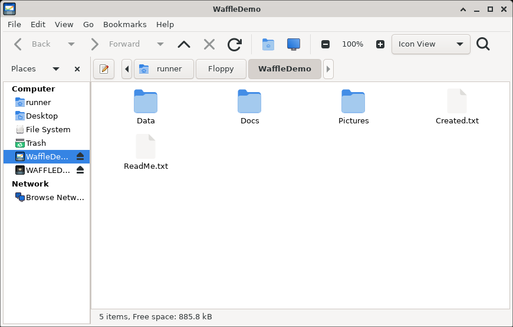 | 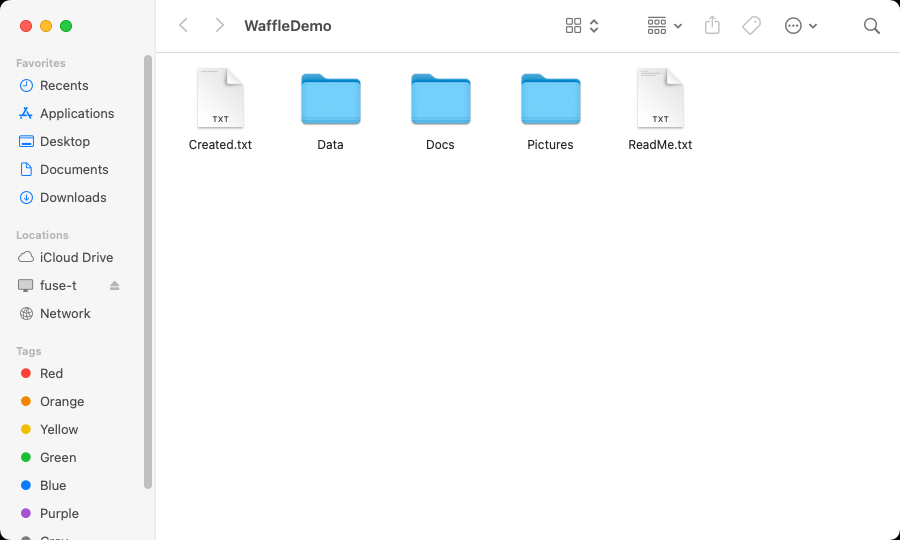 | 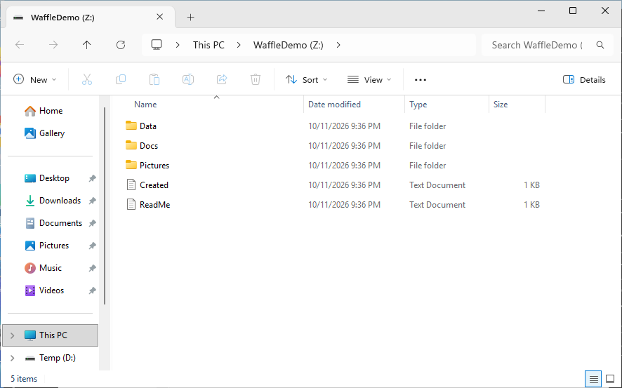 |

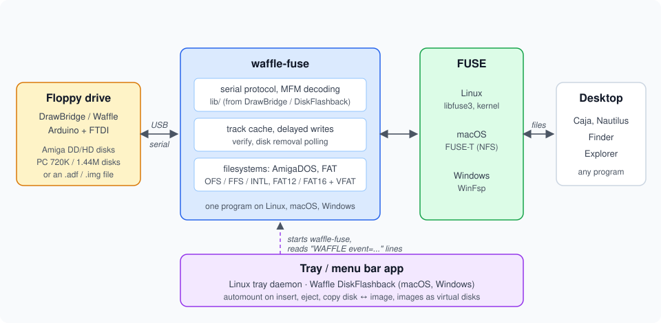

---

On **macOS** (12 or later, Apple Silicon and Intel) the driver works with
[FUSE-T](https://www.fuse-t.org), with the **Waffle DiskFlashback** menu bar app (automatic
mounting, like the Linux tray daemon) or a one-click launcher: see [macOS](#macos).

On **Windows** (10 1903 or later) the driver works with [WinFsp](https://winfsp.dev), with
the **Waffle DiskFlashback** tray app and an installer: disks and images appear as drive
letters, see [Windows](#windows).

## Origins and thanks

waffle-fuse starts from an idea of **Robert Smith** ([@RobSmithDev](https://github.com/RobSmithDev),
[robsmithdev.co.uk](https://robsmithdev.co.uk)):

* the **DrawBridge**, his Arduino floppy disk reader and writer
  ([amiga.robsmithdev.co.uk](https://amiga.robsmithdev.co.uk),
  [RobSmithDev/ArduinoFloppyDiskReader](https://github.com/RobSmithDev/ArduinoFloppyDiskReader)),
  is the hardware this driver talks to;
* **DiskFlashback**, his Windows application that mounts real floppies and disk images as
  drives ([robsmithdev.co.uk/diskflashback](https://robsmithdev.co.uk/diskflashback),
  [RobSmithDev/DiskFlashback](https://github.com/RobSmithDev/DiskFlashback)), is the model
  for what waffle-fuse does on Linux, macOS and Windows, and the reason the tray apps are
  called **Waffle DiskFlashback**. What each one does: [waffle-fuse and DiskFlashback
  compared](docs/comparison.md).

From his work came the Waffle projects by Gianluca Renzi
([@gianlucarenzi](https://github.com/gianlucarenzi)):
**WaffleCopyPRO**, the copy application for the DrawBridge / Waffle drive
([waffleCopyPRO-Universal](https://github.com/gianlucarenzi/ArduinoFloppyDiskReader/tree/master/waffleCopyPRO-Universal),
in [gianlucarenzi/ArduinoFloppyDiskReader](https://github.com/gianlucarenzi/ArduinoFloppyDiskReader)
with the Arduino firmware), and this project, which brings the DiskFlashback idea to every
desktop.

A heartfelt thank you to Robert for designing the DrawBridge, for releasing it, DiskFlashback
and their code as open source, and for years of work that keep real Amiga floppies alive on
modern computers. His DrawBridge interface code is still at the heart of waffle-fuse
(`lib/`, see [License](#license)): without it this project would not exist.

Many thanks also to the people of **RetroGiovedì** ([retrogiovedi.it](https://retrogiovedi.it))
and to **Federico Di Dato** of **Retrobit**, who believed in the Waffle from the start: the
Waffle was born with them, and thanks to them it became a product on sale for the retro
computing community ([the Waffle at RetroGiovedì](https://retrogiovedi.it/prodotto/waffle/)).

## Dependencies

The graphical installer checks them and shows the correct command for your distribution.
Manually:

| Distribution | Compilation | Daemon, tray, notifications, installer |
|---|---|---|
| Debian / Ubuntu | `sudo apt install build-essential pkg-config libfuse3-dev fuse3` | `sudo apt install python3-gi gir1.2-gtk-3.0 gir1.2-ayatanaappindicator3-0.1 libnotify-bin acl` |
| Arch / Manjaro | `sudo pacman -S --needed base-devel pkgconf fuse3` | `sudo pacman -S --needed python-gobject gtk3 libayatana-appindicator libnotify acl` |
| Fedora | `sudo dnf install gcc-c++ make pkgconf fuse3-devel` | `sudo dnf install python3-gobject gtk3 libayatana-appindicator-gtk3 libnotify acl` |
| openSUSE | `sudo zypper install gcc-c++ make pkg-config fuse3-devel` | `sudo zypper install python3-gobject typelib-1_0-Gtk-3_0 typelib-1_0-AyatanaAppIndicator3-0_1 libnotify-tools acl` |

The AppIndicator package is needed for the tray icon on Wayland, GNOME, and KDE; on X11 the
daemon has a fallback that doesn't use it.

The driver accesses the hardware via serial port (`/dev/ttyUSB0` or similar). If your user
cannot open the port, the installer adds it to the group that owns it (`dialout` on Debian
and Ubuntu, `uucp` on Arch); then you must log in again.

---

## Compatibility

**Tested** (with a real Waffle drive, FTDI FT230X):

* Debian 13 (trixie), MATE on X11, libfuse 3.17, gvfs 1.57, udisks2 2.10: reading,
  writing and formatting Amiga DD/HD and DOS 720K/1.44M, daemon in tray, automatic mounting
  in `/media/$USER`, icons on desktop (Caja), hot removal, graphical installer with polkit
  authentication, opening ADF/IMG images with double-click, copying disk to image and writing
  image to disk from tray (each track written is re-read and verified). For NDOS game ADFs it
  was verified that Amiberry is chosen as the program to pass them to, without launching it.

**Expected, not yet tested** — the code is written to work with:

* **Distributions**: Debian 11 and 12, Ubuntu 20.04 and later, Arch and derivatives, Fedora,
  openSUSE. Requirements: libfuse ≥ 3.0 (only 3.0 API is used), C++17 compiler
  (gcc ≥ 7), Python ≥ 3.7 with PyGObject and GTK 3, systemd (tmpfiles and user service),
  polkit. On **Debian 11** all are present: libfuse 3.10, gcc 10, Python 3.9, systemd 247,
  udisks2 2.9 (mounts in `/media/$USER`), `gir1.2-ayatanaappindicator3-0.1`. The only thing
  to check is the custom icon on the desktop, which uses the `IconFile` key of
  `.xdg-volume-info` read by gvfs: if an older version doesn't support it, the generic
  theme icon for removable disks would appear.
* **Desktop**: GNOME, KDE Plasma, XFCE, MATE, Cinnamon, LXQt (startup with XDG autostart);
  sway, Hyprland, i3 and other window managers (systemd user service bound to
  `graphical-session.target`). X11 and Wayland.
* **Tray icon**: AppIndicator/StatusNotifierItem on KDE, XFCE, MATE, Cinnamon, waybar and
  GNOME with "AppIndicator" extension; on GNOME without extension there's no tray and the daemon
  works with notifications only.
* **Disk icons on desktop**: GIO-based file managers (Caja, Nautilus, Nemo,
  Thunar, PCManFM). Dolphin (KDE) uses Solid and hasn't been tested.
* **macOS** 12 or later with FUSE-T: the filesystem tests pass on disk images in CI (macOS 15,
  Apple Silicon), and so does the menu bar app test (an image opened through it, written and
  unmounted on quit) with the app started from the shell. Started from the Finder, the app
  could not mount in CI (an NFS mount from the runners' GUI session fails); the drive, the
  Finder and the app started normally have not been tested on a Mac yet.

If you test it on another combination, the result is useful to add here.

---

## Building and installing

### Packages (any distribution)

Ready-made packages are attached to each release
(https://github.com/gianlucarenzi/waffle-fuse/releases; latest:
[v1.1.2](https://github.com/gianlucarenzi/waffle-fuse/releases/tag/v1.1.2)).
They are built on Debian 11 and run on **any x86_64 distribution with glibc ≥ 2.31**
(Debian 11 and later, Ubuntu 20.04 and later, Fedora, openSUSE, Arch...): libfuse3,
libstdc++ and libgcc are linked into the binary, only glibc comes from the system.

| Distribution | File | Install with |
|---|---|---|
| Debian, Ubuntu, Mint... | `waffle-fuse_<version>-1_amd64.deb` | `sudo apt install ./waffle-fuse_*.deb` |
| Fedora | `waffle-fuse-<version>-1.x86_64.rpm` | `sudo dnf install ./waffle-fuse-*.rpm` |
| openSUSE | `waffle-fuse-<version>-1.x86_64.rpm` | `sudo zypper install --allow-unsigned-rpm ./waffle-fuse-*.rpm` |
| Arch, Manjaro, EndeavourOS... | `waffle-fuse-<version>-1-x86_64.pkg.tar.zst` | `sudo pacman -U ./waffle-fuse-*.pkg.tar.zst` |
| any other | `waffle-fuse-<version>-linux-x86_64.tar.gz` | unpack, then `./install.sh` (asks for the password with sudo or pkexec) |

The package manager asks for the administrator password and installs the dependencies
(FUSE 3, Python 3 with GTK 3, acl; for the generic archive install them yourself). Everything
goes to `/opt/waffle-fuse`, with the `waffle-fuse` and `waffle-installer` commands in the PATH
and a **Waffle Installer** entry in the applications menu. The system setup (mount
directory and serial port group, see below) is done at install time for the user who ran
`sudo`; then each user starts **Waffle Installer** once for the launchers, the image
association and the tray daemon. The downloaded file can be deleted afterwards.

To remove: `sudo apt remove waffle-fuse` (or `dnf remove`, `zypper remove`,
`pacman -R`); generic archive: `/opt/waffle-fuse/install.sh --uninstall`. Use the
**Uninstall** button of Waffle Installer first to remove each user's launchers and
autostart.

The packages are built and tested (install and removal on Debian 11 and 13, Ubuntu 24.04,
Fedora, openSUSE Tumbleweed and Arch) by the GitHub workflow
`.github/workflows/build.yml`: run it from the Actions tab for test builds
(version `0.0.0.devN`), or push a tag to publish a release:

```bash
git tag v1.0.0 && git push origin v1.0.0
```

Packaging files are in `packaging/` (`nfpm.yaml` for [nFPM](https://nfpm.goreleaser.com/),
install/remove scripts, generic `install.sh`).

### macOS

Requirements: macOS 12 or later (Apple Silicon or Intel) and
[FUSE-T](https://www.fuse-t.org), free for non-commercial use and without a kernel
extension:

```bash
brew install macos-fuse-t/homebrew-cask/fuse-t      # or the installer from fuse-t.org
```

Two downloads, both universal (one binary for Apple Silicon and Intel), attached to each
release since [v1.1.0](https://github.com/gianlucarenzi/waffle-fuse/releases/tag/v1.1.0)
(test builds: the `waffle-fuse-packages-macos` artifact of the *Build waffle-fuse* workflow
in the [Actions](https://github.com/gianlucarenzi/waffle-fuse/actions) tab):

* `Waffle-DiskFlashback-<version>.dmg`: the menu bar app, with the driver inside;
* `waffle-fuse-<version>-macos-universal.tar.gz`: the command line driver and a one-click
  launcher.

The files are not signed by an Apple developer, so macOS refuses to open them the first
time: see below.

#### Waffle DiskFlashback (menu bar app)

The macOS counterpart of the Linux tray daemon. Open the `.dmg` and drag
**Waffle DiskFlashback** onto Applications. The first time macOS refuses to open it: go to
System Settings → Privacy & Security and click **Open Anyway**, or run
`xattr -dr com.apple.quarantine "/Applications/Waffle DiskFlashback.app"`. Allow the
permissions macOS asks for when the first disk is mounted.


A floppy icon appears in the menu bar: grey while waiting for a disk, orange while reading,
blue when a disk is mounted. Insert a disk and it is mounted under
`~/Floppy/<volume name>` and opened in the Finder; take it out and it is unmounted. The
menu has the same items as the [tray menu](#the-tray-menu) on Linux (Open, Eject, Mount
again, Copy disk to image file…, Write image to disk…), plus **Start at login**
(macOS 13 and later) and **Quit**, which unmounts cleanly first.

* **Floppy images**: right-click an `.adf`, `.img` or `.ima` file → Open With → Waffle
  DiskFlashback opens it as a virtual disk (the emulator stays the default application).
* **Where disks are mounted**: `~/Floppy`, or another directory with
  `defaults write io.github.gianlucarenzi.waffle-diskflashback MountDir <directory>`.
* **Log**: `~/Library/Logs/WaffleDiskFlashback.log` (driver runs, their messages and exit
  codes); start the app with `WAFFLE_DEBUG=1` in the environment for the FUSE trace.
* **Driver**: `"/Applications/Waffle DiskFlashback.app/Contents/MacOS/waffle-fuse"`.

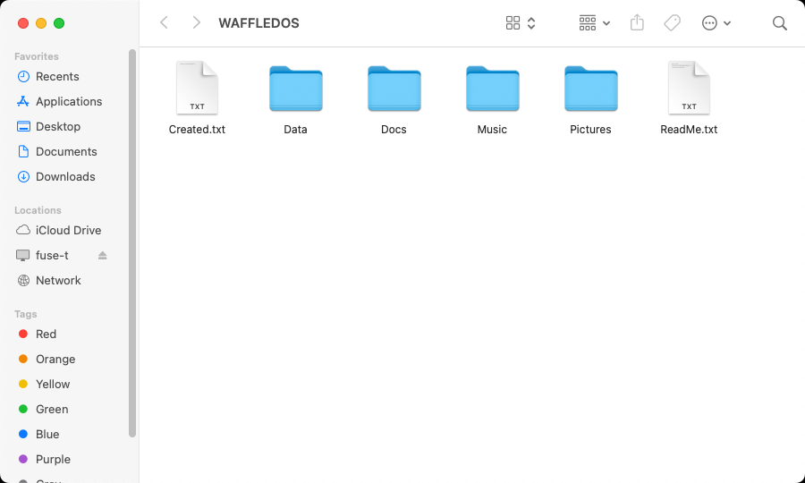

#### Command line driver and launcher

Unpack the `.tar.gz`, then remove the download quarantine:

```bash
cd waffle-fuse-*-macos-universal
xattr -dr com.apple.quarantine .
```

* **Waffle Floppy.command**: double-click it in the Finder to mount the floppy in the drive
  under `~/Floppy/<volume name>` and open it; double-click it again to eject the disk
  (pending writes are completed first). It runs `waffle-mount.sh`, the same one-click
  script as the Linux menu entries.
* **From the Terminal**: the drive is `/dev/cu.usbserial-*` or `/dev/cu.usbmodem*`
  (`ls /dev/cu.*`), unmount with `umount`; everything in [Manual use](#manual-use)
  applies, e.g. `waffle-fuse /dev/cu.usbserial-XXXX --automount ~/Floppy`.

#### How it behaves on macOS

The driver mounts with FUSE-T's options for a floppy: volume name shown in the Finder, no
`._*` AppleDouble files, `.DS_Store` or extended attributes, names in composed Unicode form
(AmigaDOS names are ISO-8859-1); the Finder and Spotlight folders (`.fseventsd`,
`.Spotlight-V100`, `.Trashes`...) are refused.

#### Building

Install FUSE-T and the command line tools (`xcode-select --install`), then `make` (the
Makefile finds FUSE-T's libfuse3 in `/usr/local`). The app: `brew install librsvg`, then
`macos/build-app.sh <version>` (needs the universal `waffle-fuse` binary, see the workflow)
and `macos/make-dmg.sh "dist/Waffle DiskFlashback.app" <file.dmg>`.

### Windows

Requirements: Windows 10 version 1903 or later (x86_64) and [WinFsp](https://winfsp.dev),
free and without reboot (`winget install WinFsp.WinFsp`).

Two downloads, attached to each release since
[v1.1.0](https://github.com/gianlucarenzi/waffle-fuse/releases/tag/v1.1.0) (test builds:
the `waffle-fuse-packages-windows` artifact of the *Build waffle-fuse* workflow in the
[Actions](https://github.com/gianlucarenzi/waffle-fuse/actions) tab):

* `waffle-fuse-setup-<version>.exe`: the installer (English and Italian). It puts
  **Waffle DiskFlashback** and `waffle-fuse.exe` in `C:\Program Files\waffle-fuse`,
  **installs WinFsp if it is missing** (bundled), and optionally starts the app at login,
  opens `.adf` images with it (`.img`/`.ima` get an *Open with* entry) and adds
  `waffle-fuse` to the PATH. The Start menu gets the app, a *waffle-fuse (Command Prompt)*
  entry and the uninstaller (also in *Installed apps*; WinFsp stays, other programs may use
  it). Updating or uninstalling first quits the app, which unmounts its disks;
* `waffle-fuse-<version>-windows-x86_64.zip`: `WaffleDiskFlashback.exe` and
  `waffle-fuse.exe` (keep them together), which need nothing but WinFsp.

The files are not signed, so SmartScreen may warn the first time: *More info* →
*Run anyway*.

#### Waffle DiskFlashback (tray app)

The Windows counterpart of the Linux tray daemon and of the macOS menu bar app. A floppy
icon appears in the notification area (click **^** if Windows hides it): grey while waiting
for a disk, orange while reading, blue when a disk is mounted. Insert a disk and it is
mounted on a free drive letter (from Z: down) and opened in Explorer; take it out and it is
unmounted. Clicking the icon opens the menu: the same items as the
[tray menu](#the-tray-menu) on Linux (Open, Eject, Mount again, Copy disk to image file…,
Write image to disk…), plus **Open image as virtual disk…** and an **Eject** item for each
open image, **Start at login**, **Show log** and **Quit**, which unmounts cleanly first.
Images also open from Explorer (*Open with → Waffle DiskFlashback*, or a double click on an
`.adf`).

* The DrawBridge is found among the USB serial ports (FTDI, CDC, CP210x, CH340...).
* Log: `%LOCALAPPDATA%\Waffle\WaffleDiskFlashback.log` (the previous run in `.old`).
* Disks in a folder instead of on drive letters: the `MountDir` string value in
  `HKEY_CURRENT_USER\Software\Waffle\DiskFlashback` (environment variables allowed, e.g.
  `%USERPROFILE%\Floppy`), then restart the app.
* `WaffleDiskFlashback.exe --quit` quits the running app; when Windows shuts down it
  unmounts first too.

| Floppies as drives in *This PC* | The tray menu, with two images open |
|---|---|
| 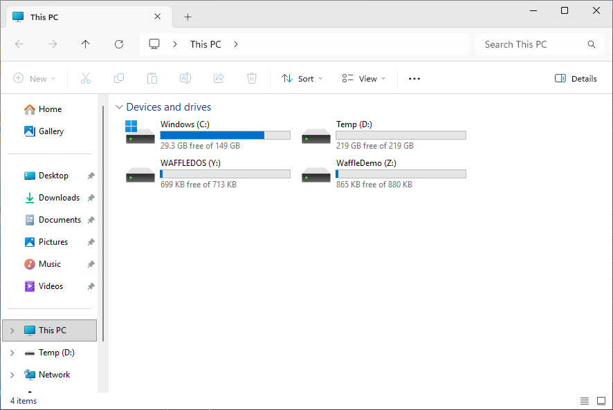 | 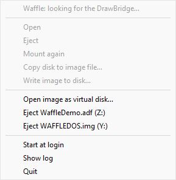 |

The installer's options:

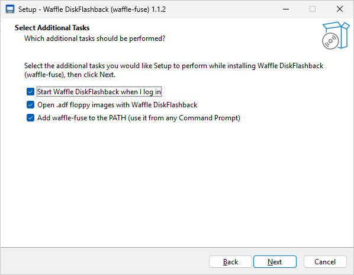

#### Command line driver

```bat
rem The drive is a COM port: Device Manager -> Ports (COM & LPT)
waffle-fuse COM3 W:
rem the first free drive letter (the one used is printed)
waffle-fuse COM3 *
rem in %USERPROFILE%\Floppy\<volume name>
waffle-fuse COM3 --automount %USERPROFILE%\Floppy
rem an image as a virtual disk
waffle-fuse --image workbench.adf W:
rem unmount, from another window (or Ctrl+C in the waffle-fuse window)
waffle-fuse --unmount W:
```

#### How it behaves on Windows

* waffle-fuse always stays in the foreground (`-f` is accepted and ignored); unmount with
  Ctrl+C in its window or `waffle-fuse --unmount <mountpoint>`.
* The mountpoint is a drive letter, `*` for the first free one (from Z: down), or a
  directory that **does not exist yet**: WinFsp creates it and removes it on unmount.
* Explorer shows the volume name as the drive label and `FUSE-AFFS` / `FUSE-FAT` as the
  file system; names are case-insensitive, as on the Amiga and in DOS.
* The Recycle Bin (`$RECYCLE.BIN`) is refused, so Explorer offers to delete
  permanently; there is no `.xdg-volume-info`.
* Amiga names may contain characters Windows does not allow (`* ? " < > | \`): WinFsp
  shows them as look-alike Unicode characters.

#### Building

With [MSYS2](https://www.msys2.org) (UCRT64 shell) and WinFsp installed with its developer
files (`msiexec /i winfsp-<version>.msi INSTALLLEVEL=1000`, or *Developer* ticked in the
installer):

```bash
pacman -S --needed make mingw-w64-ucrt-x86_64-gcc
make                      # waffle-fuse.exe; WINFSP_INC=... if WinFsp is elsewhere
tests/run-tests.sh        # filesystem tests (needs dosfstools)
```

From Linux, with a MinGW-w64 cross compiler and the WinFsp headers (the `inc` folder of
the WinFsp sources):

```bash
make CXX=x86_64-w64-mingw32-g++-posix WINFSP_INC=/path/to/winfsp/inc
```

The installer is built with [Inno Setup 7](https://jrsoftware.org/isinfo.php) from
`windows/waffle-fuse.iss`: a 64-bit installer (`SetupArchitecture=x64`; Inno Setup 6 still
works and builds a 32-bit one). On Windows (MSYS2) or on Linux through wine (`wine64` is
enough; Inno Setup installed in the default wine prefix, `ISCC=` and `WINE=` choose
others). The script downloads the WinFsp MSI to bundle and checks its SHA-256:

```bash
windows/make-installer.sh 1.1.0      # -> dist/waffle-fuse-setup-1.1.0.exe
```

### Installation from source

```bash
git clone https://github.com/gianlucarenzi/waffle-fuse.git
cd waffle-fuse
make
./scripts/waffle-installer.py        # or double-click waffle-installer.desktop
```

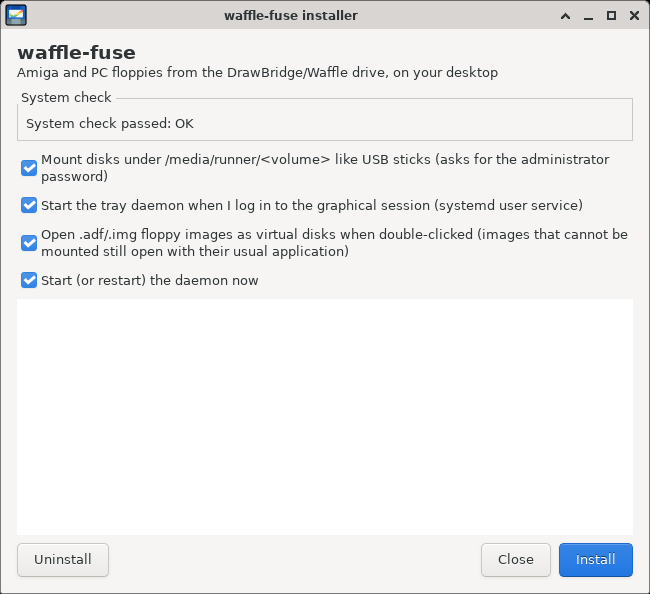

The graphical installer (GTK; designed for X11 and Wayland, for any desktop and for Debian,
Arch, Fedora and openSUSE: see Compatibility for what has been tested) checks dependencies
and suggests missing packages for your distribution, compiles waffle-fuse if needed, then:

* **for the user**: installs launcher and icons and starts **Waffle DiskFlashback** (the daemon
  with the tray icon) when the graphical session starts, with XDG autostart (GNOME, KDE,
  XFCE, MATE, Cinnamon, LXQt) or with a systemd user service bound to
  `graphical-session.target` on window managers without autostart (sway, Hyprland, i3...);
  if you keep the checkbox active, associates floppy images (`.adf`, `.img`, `.ima`) with
  waffle-fuse, so double-click opens them as virtual disks (see below);
* **for the system**: asks for the administrator password with the standard polkit window
  (`pkexec`; otherwise `sudo -A` with a graphical askpass) and runs
  `scripts/install-system.sh`, to mount disks where udisks mounts them and to grant access
  to the serial port (group `dialout` or `uucp`, only if needed).

It also has an uninstall button. Without graphical interface: `waffle-installer.py --text`.

The tray icon uses AppIndicator/StatusNotifierItem (package
`gir1.2-ayatanaappindicator3-0.1` on Debian, `libayatana-appindicator` on Arch), necessary
on Wayland, GNOME (with the AppIndicator extension) and KDE; on X11 there's a fallback
without it. Without tray the daemon still works, with notifications only.

### The tray menu

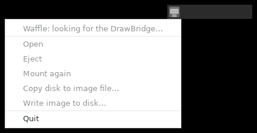

The icon follows the state of the drive (the same on Linux, macOS and Windows):

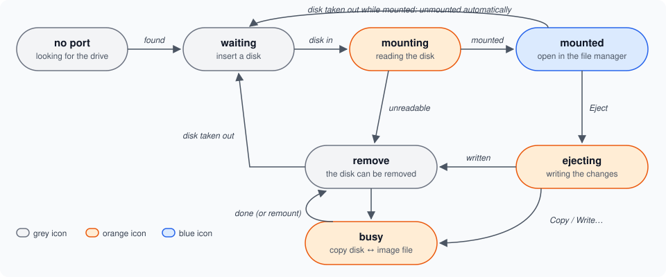

| Menu item | What it does |
|---|---|
| **Open** | opens the mounted disk in the file manager (also with a click on the icon) |
| **Eject** | unmounts the disk: writes pending changes, then notifies that you can remove it |
| **Mount again** | remounts an unmounted disk that's still in the drive |
| **Copy disk to image file…** | copies the disk in the drive to a file: `.adf`/`.img` copies the sectors (also of game NDOS disks, as Amiga disk), `.scp` records the raw magnetic flux, even of protected disks. Proposes the volume name and the folder `~/WaffleFolder` if it exists. About 1 minute for a DD `.adf` |
| **Write image to disk…** | writes an `.adf`/`.img`/`.ima` image to the disk in the drive, which is overwritten (asks for confirmation). Proposes the image open as a virtual disk and closes it first, so everything is in the file. By default rewrites only different tracks; the "Erase and rewrite every track" checkbox erases and rewrites them all (about 2.5 minutes for a DD). Each track written is re-read and verified |
| **Quit** | cleanly unmounts the disk and closes the daemon |

During a copy or write the mounted disk is unmounted (the serial port is needed for the
operation) and remounted at the end: after a write with the new content. A window shows
the progress track by track; **Cancel** stops the operation between one track and the next,
never in the middle of a track. The copy is done in a temporary file (`….part`) renamed
only at the end: cancelling doesn't lose a file being overwritten.

### Floppy images as virtual disks

To try without a drive, two small demo images are in [`docs/examples`](docs/examples):
`WaffleDemo.adf` (Amiga 880K, FFS) and `WAFFLEDOS.img` (PC 720K, FAT12), with a few files
and folders (`docs/examples/make-examples.sh` builds them with waffle-fuse itself).

With double-click on an `.adf`, `.img` or `.ima` image (`scripts/waffle-open-image.py`):

* AmigaDOS (OFS/FFS) and FAT images are mounted in read and write mode in the same
  folder as real disks, with the icon on the desktop, and the file manager opens. Changes
  go directly to the image file; close with "Unmount" on the icon. A second double-click
  on an already open image opens only the window. A file without write permission is opened
  read-only;
* images that waffle-fuse cannot mount (NDOS game disks, protected disks, images larger
  than a floppy) are passed to the program that opened them before (e.g. Amiberry for
  ADFs or the desktop image mounter).

The association follows XDG standards (shared-mime-info, `mimeapps.list`), so it applies
to all desktops: the interested types are `application/x-amiga-disk-image`,
`application/x-amiga-disk-format`, `application/vnd.efi.img` and
`application/x-raw-disk-image`. Programs associated before are remembered in
`~/.config/waffle-fuse/previous-handlers` and reassociated on uninstall.
Manually: `scripts/install-desktop.sh --no-image-handler` removes only the association.

Warning: changes made on a virtual disk go into the file itself. To keep an original ADF
intact, open a copy.

### Waffle ModPlayer (a surprise on the floppies)

Double-click a music module (`.mod`) on a disk mounted by waffle-fuse, and it plays in
**Waffle ModPlayer**, with the VU meters of WaffleCopyPRO, one bar per channel, a sine
scroller and a copper bar title. The demo floppy has one:
[`Music/waffle.mod`](docs/examples) on `WaffleDemo.adf`.

| Linux | macOS | Windows |
|---|---|---|
| 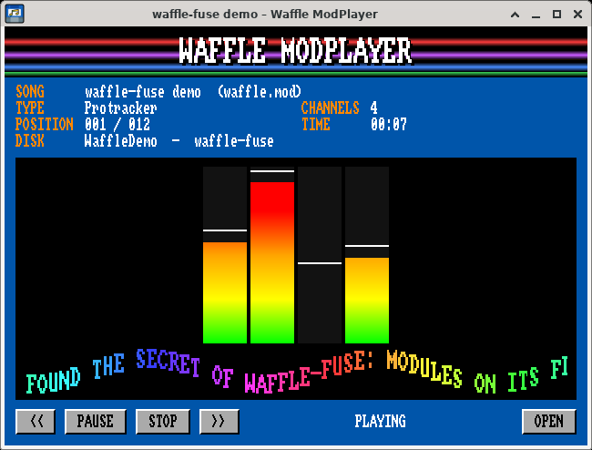 | 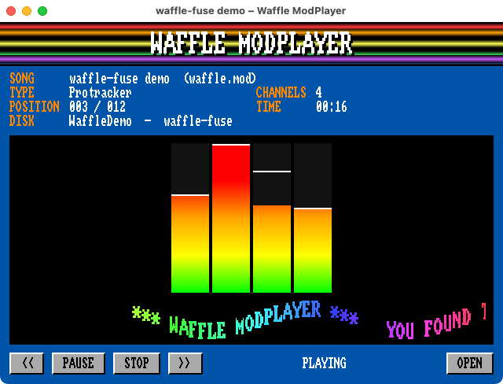 | 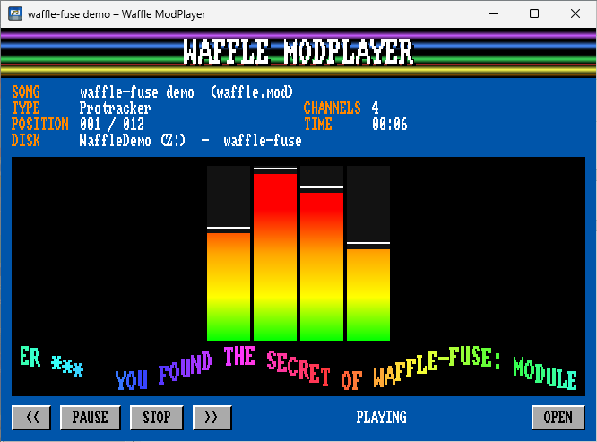 |

* **Linux**: in the packages, with its own Qt 6 in `/opt/waffle-fuse/modplayer` (no Qt
  needed on the system). `install-desktop.sh` makes it the program for `audio/x-mod`; a
  module that is *not* on a waffle-fuse disk goes on to the program that played modules
  before (remembered in `~/.config/waffle-fuse/previous-handlers`, given back on
  uninstall; `--no-mod-handler` leaves modules alone).
* **macOS**: *Waffle ModPlayer.app* in the disk image, next to Waffle DiskFlashback
  (universal: Apple Silicon and Intel, macOS 12 or later). Drag it to Applications too: it
  opens modules when no other application does, and is always in *Open With*.
* **Windows**: installed in `C:\Program Files\waffle-fuse\ModPlayer` (also in the zip),
  in *Open with* for `.mod` files, and their default program when no other one has them.

Keys: Space pause, S stop, ← → previous/next pattern, O open, Esc quit; modules can also
be dropped on the window. It plays what libmikmod plays (`.mod`, `.xm`, `.s3m`, `.it`,
`.med`, `.669`, `.mtm`...). How it knows a waffle-fuse disk: the mount source
`waffle:<drive or image>` (Linux; on macOS also the volume icon that waffle-fuse serves),
the file system name `FUSE-AFFS` / `FUSE-FAT` (Windows).

From source (Qt 6 and libmikmod development files, CMake):

```bash
make modplayer                 # builds ./waffle-modplayer
./scripts/install-desktop.sh   # registers it for .mod files (Linux)
```

Release builds link libmikmod statically (`modplayer/build-libmikmod.sh`: only the
native audio outputs) and carry Qt (`modplayer/bundle-linux.sh`, `macdeployqt`,
`windeployqt`). Tests: `tests/test-modplayer.sh`.

### Where disks are mounted

The mount folder takes the name of the Amiga volume or FAT label; if the disk
has no name it's called `FloppyDDAFFS`, `FloppyHDAFFS`, `FloppyDDDOS` or `FloppyHDDOS`.
It's created where udisks mounts USB sticks, `/media/$USER` (Debian, Ubuntu) or
`/run/media/$USER` (Arch, Fedora...), if the system part is installed; otherwise in
`~/Floppy`.

udisks2 creates that folder by itself, owned by root with an ACL read-only for the user,
and only when mounting a block device; waffle-fuse runs as user and can't create folders
there. `scripts/install-system.sh` (launched by the installer, or manually with `sudo`,
`--uninstall` to remove) installs `/etc/tmpfiles.d/waffle-fuse.conf`, with which systemd
creates the folder at every startup with an ACL that also gives the user write permission,
and applies it immediately. udisks2 sets its permissions only when creating the folder, so
it keeps working as before.

Daemon options: `--port /dev/ttyUSB0` (default: autodetect), `--mount-dir DIR`
(default as above; must be under `/media`, `/run/media` or in the home for icons to appear
on the desktop), `--open` (opens the file manager on insertion), `--ro` (always mounts
read-only).

To use the port with WaffleCopyPRO first close the daemon (menu → Quit):
the serial port is open exclusively.

---

## How it behaves (like trackdisk.device)

* **Track cache**: a full track is always read; subsequent reads on the same track don't
  touch the disk.
* **Deferred write**: writes go to cache and the track is written about 1 second after
  the last change (option `flushdelay`), then **re-read and verified**
  (up to 3 attempts). Copying a file doesn't rewrite the same track dozens of times.
* **No invented data**: an unreadable sector is never "guessed". The file containing it
  gives an I/O error, and a track with unreadable sectors is never rewritten, so corrupted
  sectors are not overwritten with zeros.
* **Motor**: turns off after 3 seconds of inactivity and turns back on when needed.
* **Removal**: with the disk stopped the drive is checked every 3 seconds (like
  trackdisk.device; adjustable with `diskpoll`). If the disk
  disappears, the volume is unmounted. If there were still pending changes an error message
  arrives, because those changes are lost: wait for the "you can remove" message
  before taking out the disk, as on Amiga.
* **Desktop**: in the disk root a `.xdg-volume-info` and a
  `.waffle-icon.svg` *virtual* file appear (read-only, never written to disk) with the volume
  name and Amiga or DOS icon, which file managers use for the desktop icon. The icon is
  given as a file (`IconFile`), because with a GTK theme name it would prefer the generic
  "removable disk" icon from the active theme. An already-present `.xdg-volume-info` on the
  disk is hidden.
* **No trash on floppy**: `.Trash`/`.Trash-<uid>` folders are rejected, so the file manager
  offers to delete permanently instead of filling the disk with deleted files (option `trash`
  to re-enable it).
* **Unmounting**: after `fusermount3 -u` (or "Unmount"/"Eject") the process writes what's
  left, frees the drive and removes the mount directory.

---

## Manual use

```
waffle-fuse <serial-port> <mountpoint> [options]
waffle-fuse <serial-port> --automount <dir> [options]     # mounts in <dir>/<volume name>
waffle-fuse --image <file.adf|file.img> <mountpoint> [options]
waffle-fuse --probe <port>          # 0 = disk present, 1 = no disk, 2 = error
waffle-fuse --wait-disk <port>      # waits for disk insertion
waffle-fuse --wait-removal <port>   # waits for disk removal
```

Tools for the disk (without mounting):

```
waffle-fuse --format <port> <type> <dd|hd> [name] [--quick] [--yes] [--force]
waffle-fuse --format-image <file> <type> <dd|hd> [name]   # creates an empty image
waffle-fuse --scan <port>                # surface map: good sectors per track
waffle-fuse --dump <port> <file.adf|img|scp> [--format amiga|dos] [--density dd|hd]
            [--tracks N] [--revs N]       # copies entire disk to an image
waffle-fuse --write-image <port> <file.adf|img> [--full] [--yes] [--force]
                                          # writes an image to disk: by default re-reads
                                          # each track and rewrites only the different ones
```

`--dump` chooses the copy type from the extension: `.adf`/`.img` copies sectors of the
recognized format (a non-DOS disk is copied as an Amiga disk, unreadable sectors become
zeros and are counted); `.scp` records the magnetic flux
(`--tracks`, default 80, up to 84; `--revs`, revolutions per track, default 3, up to 5).
`--write-image` rejects a DD image on an HD disk (or vice versa) without `--force`.
`--dump`, `--write-image` and `--format` stop between tracks with Ctrl+C or
SIGTERM, leaving the drive in a clean state.

`<type>`: `ffs` (or `amiga`), `ofs`, `amiga-intl`, `ofs-intl`, `dos`. Formatting
erases each track, rewrites it and re-reads it to verify (about 2 minutes), then
creates the filesystem: AmigaDOS like AmigaOS Format (DD 880K, HD 1.76M), FAT12 like
MS-DOS (720K, 1.44M). `--quick` rewrites only tracks with filesystem structures
and requires an already formatted disk. Without `--yes` it asks to type YES.
A DD disk is not formatted as HD (or vice versa) without `--force`.

```bash
./waffle-fuse --format /dev/ttyUSB0 ffs dd "Work"
./waffle-fuse --format /dev/ttyUSB0 dos hd "DATA"
```

The disk is read and recognized **before** mounting: with a wrong or
unreadable disk the command exits with an error and doesn't leave hanging mount points.

### Options (`-o key[=value],...`)

| Option | Description |
|--------|-------------|
| `format=fat\|affs` | Force filesystem type (default: autodetect) |
| `density=dd\|hd`  | Force density (default: autodetect, trying both) |
| `ro`              | Mount read-only |
| `flushdelay=MS`   | Deferred write delay (default 1000 ms) |
| `noverify`        | Don't re-read written tracks (faster, less safe) |
| `diskpoll=MS`     | Removal check interval (default 3000 ms, like trackdisk.device) |
| `trash`           | Allow file managers to create `.Trash-<uid>` trash on disk |
| `novolumeinfo`    | No virtual `.xdg-volume-info` (name and icon on desktop) |
| `debug_hw`        | Hardware/serial debug output |
| `-f`              | Stay in foreground |

### Examples

```bash
# Mount inserted disk in ~/Floppy/<volume name>, in background
./waffle-fuse /dev/ttyUSB0 --automount ~/Floppy

# In a fixed mount point, in foreground with debug
mkdir -p /tmp/floppy
./waffle-fuse /dev/ttyUSB0 /tmp/floppy -f -o debug_hw

# Unmount (writes pending changes)
fusermount3 -u ~/Floppy/Workbench3.1

# Work on an ADF/IMG image instead of the drive
./waffle-fuse --image workbench.adf /tmp/wb
```

There's also `scripts/waffle-mount.sh [auto|amiga|dos] [auto|dd|hd] [port]`, used by
the menu launchers: if the disk is mounted it unmounts, otherwise it mounts.

### Exit codes

| Code | Meaning |
|------|---------|
| 0 | unmounted normally, all changes written |
| 1 | error in arguments or mounting |
| 2 | serial port cannot be opened (disconnected or in use) |
| 3 | no disk in drive |
| 4 | non-DOS disk: not formatted, NDOS (games) or protected |
| 5 | drive error reading track 0 |
| 6 | invalid filesystem |
| 7 | disk removed: unmounted automatically |
| 8 | disk removed with pending changes (lost) |
| 9 | some changes were not written |

A line is printed to stdout for each event (`WAFFLE event=detected ...`,
`WAFFLE event=mounted mountpoint=...`, `WAFFLE event=removed`, ...), read by the daemon.

---

## Testing

Filesystems are tested on disk images, without hardware:

```bash
make test
```

The test copies a file tree onto freshly formatted images (OFS, FFS, FFS-INTL,
FFS HD, FAT 720K and 1.44M), then moves, renames, truncates, appends, deletes and fills the
disk. Finally it compares the result three times: from the mount, after a fresh mount and with
independent tools (`xdfscan`/`xdftool` from [amitools](https://github.com/cnvogelg/amitools)
for AmigaDOS, `fsck.fat` and [pyfatfs](https://github.com/nathanhi/pyfatfs) for FAT). If
the tools are in a virtualenv:

```bash
python3 -m venv ~/waffle-venv && ~/waffle-venv/bin/pip install amitools pyfatfs "setuptools<70"
XDFTOOL=~/waffle-venv/bin/xdftool XDFSCAN=~/waffle-venv/bin/xdfscan \
TEST_PYTHON=~/waffle-venv/bin/python make test
```

On macOS the tests need FUSE-T and GNU coreutils and dosfstools first in `PATH`
(`brew install coreutils dosfstools`), as the CI does.  For debugging: `ONLY="FAT 720K"`
runs a single suite, `WAFFLE_DEBUG=1` mounts with the FUSE trace (`-d`), `LOG_TAIL=N`
shows N lines of the driver log on each failure.

---

## Troubleshooting

**"Transport endpoint is not connected" on a mount directory** (in `/media/$USER`,
`/run/media/$USER` or `~/Floppy`): it's left over from a crash. Clean it with
`fusermount3 -uz <directory>`; the daemon does it by itself on startup.

**On the desktop the disk has a USB stick icon**: the file manager doesn't use the icon
provided by the virtual disk (see Compatibility); name and operation don't change. After
installing the icons it may help to restart the file manager (`caja -q`, `nautilus -q`).

**The tray icon doesn't appear**: on Wayland, GNOME and KDE the AppIndicator package is needed
(see Dependencies); on GNOME also the "AppIndicator and KStatusNotifierItem" extension.

**"cannot open device"**: check `ls -l /dev/ttyUSB0`, that you're in the `dialout` group
and that no other program (WaffleCopyPRO, another `waffle-fuse`) is using the port.

**"Disk in use" on eject**: a file manager window or terminal is inside the
disk. Close them and try again.

**Disk recognized incorrectly**: force format and density, for example
`-o format=affs,density=dd`.

---

## Screenshots

The pictures in this README are taken by the *Screenshots* workflow
(`.github/workflows/screenshots.yml`, scripts in `docs/screenshots/`) on the Linux, macOS
and Windows desktops of the GitHub runners, with the demo images of `docs/examples`: run it
from the Actions tab and commit the PNG files of its `screenshots` artifact to
`docs/images/screenshots/`.

---

## Architecture

```
waffle_fuse.cpp          – main(): detects disk, chooses filesystem, mounts, events
├── disk_cache.h/cpp     – IDiskImage; WaffleDisk (per-track cache, deferred
│   │                      and verified write, motor, removal detection); ImageDisk (file)
│   └── ADFWriter        – MFM Amiga and IBM encode/decode, serial I/O
├── fat_fs.h/cpp         – FAT12/FAT16 with long VFAT names
├── format.h/cpp         – empty AmigaDOS OFS/FFS and FAT12 images (DD and HD)
└── affs_fs.h/cpp        – Amiga OFS/FFS (ISO-8859-1 ↔ UTF-8 names, dates in local time)
scripts/
├── waffle-installer.py     – graphical installer (GTK or text): user + system via polkit
├── install-system.sh       – system part (root): /media or /run/media, serial port
├── install-desktop.sh      – launcher, icons and autostart (used by installer)
├── waffle-diskflashback.py – tray daemon: automount, eject, disk copy and write
├── waffle-open-image.py    – opens a floppy image as a virtual disk (double-click)
└── waffle-mount.sh         – mount/unmount with a click (launcher)
waffle-installer.desktop    – opens the installer with a double-click
waffle-open-image.desktop   – handler for .adf/.img/.ima images (not shown in menu)
mime/waffle-fuse.xml        – MIME types for *.adf and *.ima where the system doesn't define them
icons/                      – disk icons (also embedded in the binary) and tray icon
tests/run-tests.sh          – filesystem tests on images
```

---

## Known limitations

* On AmigaDOS names can be at most 30 characters (ISO-8859-1); links (hard
  and soft) can be read but not modified.
* Amiga volumes with unvalidated bitmap (disk to "validate") or with wrong root block
  checksum are mounted read-only (the reason is written to the log): validate them on
  an Amiga or in an emulator. To repair a disk from a good image there's `--write-image`.
* FAT32, sectors other than 512 bytes and Amiga partitioned disks (RDB) are not supported.
* A disk change faster than the check interval (3 s) may not be noticed (the drive signals the
  change only with the DSKCHG line): always unmount before changing the disk.
* `.ipf` files are not supported.

---

## License

waffle-fuse is distributed under the GNU General Public License version 3 (GPL-3.0), see
[LICENSE](LICENSE). The DrawBridge interface code in `lib/` by Robert Smith keeps the
licensing stated in its file headers (Mozilla Public License 2.0 or GNU GPL version 2 or
later), compatible with distributing the whole under GPL-3.0.

Waffle ModPlayer uses [Qt 6](https://www.qt.io) (LGPL-3.0, dynamically linked, carried in
the packages as unmodified libraries) and [libmikmod](https://mikmod.sourceforge.net)
(LGPL-2.0 or later). Its VU meters and scroller come from WaffleCopyPRO; the Amiga font is
*Topaz Plus* by dMG of Trueschool and Divine Stylers, freely distributable.

Thanks to Robert Smith for the DrawBridge and DiskFlashback, from which this project
started, and to RetroGiovedì and Federico Di Dato (Retrobit) for the Waffle: see
[Origins and thanks](#origins-and-thanks).
